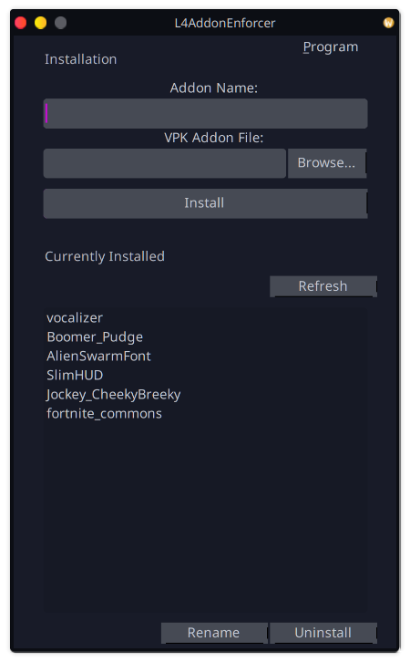
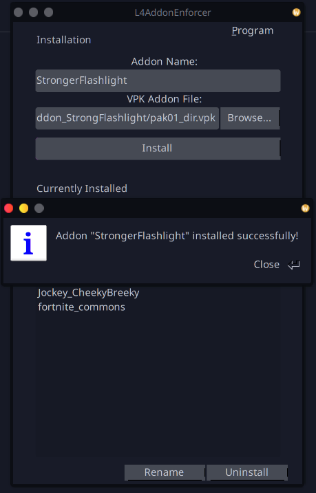
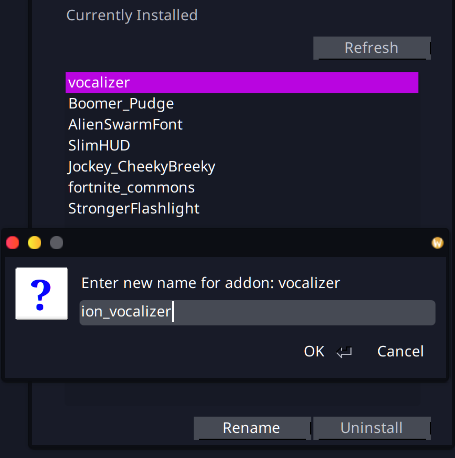
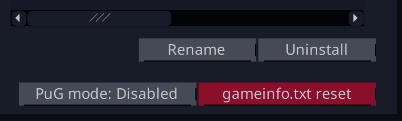

L4AddonEnforcer
-----------
An addon installer for Left 4 Dead 2 that will let you use them on official servers.

### GUI
 


Since v0.3.0 there's a PuG mode switch (on/off) to temporarily restore the vanilla backup, to let you play on servers that impose file consistency. As well as a button to completely and irreversibly reset the current gameinfo to the default.



Since v0.5.0 there's a different scheme of CLI commands. The commands are now divided between subcommands that perform it's own function. E.g. Installation, Listing, PuG mode, etc.

### CLI Usage

#### Installation

`L4AddonEnforcer install -f <path to the *.vpk> -n <name>`

**`install`** or **`i`** corresponds to the subcommand for installation.

**`-f`** corresponds to the original VPK addon file that will be copied (as pak01_dir.vpk) to the later created addon directory.

**`-n`** corresponds to the common name of the addon, a directory that will be named after, and an entry in the gameinfo.txt.
You can name it whatever you like, to later know what that addon is.
Since 0.5.0 optional due to the added autoinstall function that extracts and constructs name from the addon.

Example (linux): `./L4AddonEnforcer install -f /home/user/Downloads/ion_vocalizer.vpk -n vocalizer`</br>
Example (windows): `L4AddonEnforcer.exe install -f C:\Users\User\Downloads\ion_vocalizer.vpk -n vocalizer`

**The same way you can update an already installed addon.**

#### List of already installed addons

`L4AddonEnforcer list`

**`list`** or **`l`** corresponds to the subcommand for listing.

Example output: 
```
Installed addons:
        vocalizer
        fortnite_commons
        AlienSwarmFont
        SlimHUD
        Jockey_CheekyBreeky
        Boomer_Pudge
```

Since 0.5.0 there is a **`-d`** argument to print metadata extracted from the addon.

***The list doesn't include the base game components***
#### Uninstallation

`L4AddonEnforcer uninstall -n <name>`

**`uninstall`** or **`u`** corresponds to the subcommand for uninstallation.

**`-n`** corresponds to the name of the already installed addon.

Example (linux): `./L4AddonEnforcer -u AlienSwarmFont`</br>
Example (windows): `L4AddonEnforcer.exe -u AlienSwarmFont`

#### Renaming

`L4AddonEnforcer rename -c <current_name> -n <new_name>`

**`rename`** or **`r`** corresponds to the subcommand for renaming.

**`-c`** corresponds to the current name of the already installed addon.

**`-n`** corresponds to the new name of the addon.

Example (linux): `./L4AddonEnforcer -r vocalizer -n ion_vocalizer`</br>
Example (windows): `L4AddonEnforcer.exe -r vocalizer -n ion_vocalizer`

#### PuG Mode

PuG mode temporalily switches the current gameinfo.txt file with the original gameinfo.txt file backup, if there is a need to play on servers that impose file consistency.

`L4AddonEnforcer pug < -c | -s >`

**`pug`** or **`p`** corresponds to the subcommand for managing the PuG mode.

**`-c`** checks the current status of the PuG mode.

**`-s`** switches the PuG mode.

#### More usage...

Use `L4AddonEnforcer -h` (simple) or `L4AddonEnforcer --help` (detailed) to learn more.
